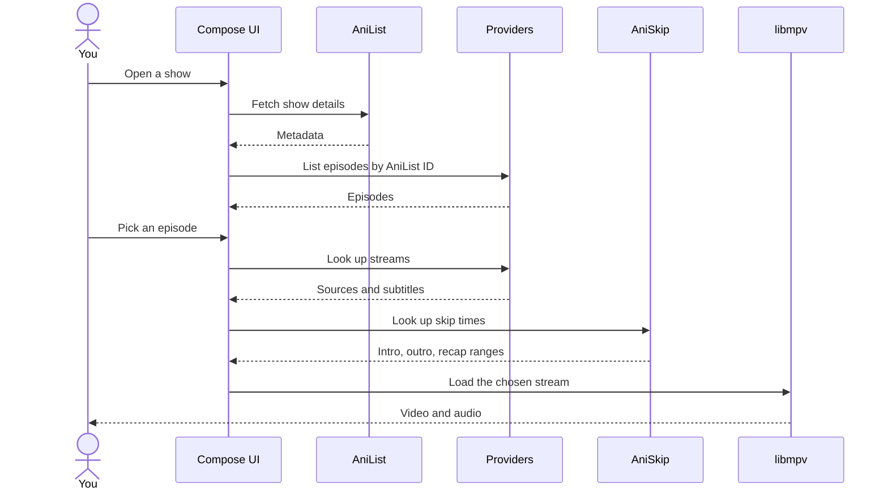

# AniLife for desktop: MAL fix and personal Windows build

> **This is an unofficial personal fork** of [anilifecommunity/kotlindesktop](https://github.com/anilifecommunity/kotlindesktop).
> It differs from the original in two ways, and builds its own Windows installers with GitHub Actions.

## What is different from the original

| Change | Why |
| --- | --- |
| **MyAnimeList sign-in uses the `plain` PKCE method.** | MAL only supports `plain`. The original sent `S256`, so the token step failed with "invalid grant" after a successful browser login. Sent upstream as [PR #2](https://github.com/anilifecommunity/kotlindesktop/pull/2). |
| **The in-app update check reads this fork's releases**, not the original's. | So installs from here update from here. See `Updater.kt`. |
| **Settings, Data has backup and MyAnimeList files**: Back up to a file, Restore from a backup, Export MyAnimeList XML, Import MyAnimeList XML. | Matches the Android app's Data screen, and uses the same file formats, so you can move your list between the phone and this PC by hand. The backup carries saved anime, Continue Watching and the settings both apps share. See `AppBackup.kt`, `MalTransfer.kt` and `DataTransfer.kt`. |

Everything else is the original code, kept up to date by the sync below.

## Download

Open the [Releases](../../releases) page and download `anilife-<version>.base.exe` (or the `.msi`, or the portable versions) from the latest release. The `.exe` is a setup wizard: it asks for the install folder, the Start Menu folder and a desktop shortcut, then offers to launch AniLife or open this page (both ticked). The Start Menu page has a "Don't create a Start Menu folder" box. Uninstalling asks whether to also delete all settings and data in `%LOCALAPPDATA%\AniLife` (ticked by default). Installing it over an older `.msi` install removes the `.msi` copy first; your settings and `.env` are kept. The portable `.exe` is a single self-extracting file that installs nothing. The installers are **not code-signed**, so Windows SmartScreen may warn. Choose "More info", then "Run anyway", if you trust the source.

## How the automation works

Three workflows in `.github/workflows` run in a chain:

| Workflow | What it does | When it runs |
| --- | --- | --- |
| **Sync from upstream** (`sync-upstream.yml`) | Merges the original repo's latest commits into `main`, keeping this fork's edits. It never takes workflow files or this README from upstream. Then it starts a build only if the version in `app/build.gradle.kts` has no release here yet. | Every Monday at 00:30 Austin time (America/Chicago), or manually |
| **Build Windows installers** (`build-windows.yml`) | Runs the tests, builds the `.msi` and `.exe` installers (normal and portable) and uploads them as the artifact `Anilife-Windows-Installers` (kept 90 days). On success it starts the release workflow. | Started by the sync, or manually |
| **Publish release from a build run** (`release-from-run.yml`) | Creates the tag `v<version>` and a GitHub release with the installers attached. If the release exists, it replaces the files. | Started by the build, or manually with a run ID |

If the original and this fork changed the same lines, the sync stops, changes nothing and shows the
conflicting files in its log. A new release appears only when the version number goes up. Tick
**Force build** on the sync to build anyway. A fork-only change with the same version number does not
reach installed apps, because the updater only offers a higher version.

**Version names.** Releases here are named after the original's newest published release plus this fork's own revision number, for example `1.0.6-AK3`. The name comes from `fork-version.properties`: `base` follows the original project (the weekly sync moves it up by itself once the original publishes a newer release, and the revision starts again at 1), and `revision` is raised by hand when this fork ships changes of its own. The original's version line in `app/build.gradle.kts` is left as upstream writes it, so their version bumps never conflict. The updater ranks `1.0.6-AK3` above `1.0.6` and below `1.0.7`. The installer itself still uses the plain `1.0.6` inside, because Windows installers only accept numbers, so to install over a different build, uninstall the old one first.

To run a workflow by hand, open the **Actions** tab, pick it and use **Run workflow**.

## MyAnimeList setup

Create an app at <https://myanimelist.net/apiconfig> with type `other` and the redirect URL
`http://localhost:8765`, then put its Client ID in the app's Settings (or in `MAL_CLIENT_ID`).

## About the app

The original project's description follows.

---

# AniLife for desktop

[](https://github.com/anilifecommunity/kotlindesktop/actions/workflows/build.yml)
[](https://kotlinlang.org)
[](#install)

[](https://github.com/anilifecommunity/kotlindesktop/releases/latest)
[](https://github.com/anilifecommunity/kotlindesktop/actions/workflows/build.yml?query=branch%3Amain+is%3Asuccess)

A Windows desktop client for watching anime, written in Kotlin with Compose Multiplatform. It is a port of AniLife to the JVM. Show data comes from AniList, and playback goes through libmpv.

## What it does

- Browses and searches AniList, with a weekly airing schedule and a library of what you are watching.
- Finds streams through the Miruro catalog API and through seven bundled WebAssembly provider modules: animeheaven, animeonsen, animepahe, anipm, anizone, megaplay and rift. The modules run in wasmtime.
- Plays video with libmpv, with subtitle tracks, subtitle delay, speed control and keyboard shortcuts.
- Skips intros, outros and recaps using AniSkip data when it exists for an episode.
- Syncs your list with MyAnimeList.
- Shows what you are watching in Discord, if the Discord desktop client is running.
- Queues episode downloads, plays local files, and posts a notification when a new episode of a show in your library has aired.
- Has a command palette for jumping between screens.

## Install

Builds are on the [Releases](../../releases) page. There are two kinds, each as an `.msi` and an `.exe`:

- The base build is a normal installer. It adds a Start Menu entry and a desktop shortcut, and you remove it from Windows Settings.
- The portable build installs nothing system-wide. The portable `.msi` installs per user, with no shortcuts, into a folder you pick. The portable `.exe` is one file that unpacks to a temporary folder and starts the app.

The latest release is the stable build. The latest beta is the newest successful run of the Build workflow on `main`. Open the run and scroll to Artifacts. Beta builds are untested, and GitHub asks you to sign in before it lets you download from Actions. The files download as plain files, not zips.

## First launch

AniLife needs libmpv. If it cannot find one, it downloads the latest 64-bit LGPL build of `libmpv-2.dll` from the mpv releases into `%USERPROFILE%\.anilife`. To use your own copy, start the app with `-DAniLife.mpv.library=<path to libmpv>`. Settings, then About, shows which library is loaded.

## MyAnimeList sign-in

Sign-in needs your own API client IDs. Open the Profile page and press Connect: if the ID is empty, a pop-up asks for it (MyAnimeList client ID, or AniList client ID and an optional secret), hidden as you paste, with Save, Connect and Cancel. The pencil on each account row edits the values later. They live in `.env` in `%LOCALAPPDATA%\AniLife`, which the app creates blank on first start, and saving one service never touches the other's. A `.env` beside the program, or the `MAL_CLIENT_ID`, `ANILIST_CLIENT_ID` and `ANILIST_CLIENT_SECRET` environment variables, still work. Without an ID, the rest of the app is unaffected.

## Build from source

You need JDK 21. Gradle downloads everything else.

```
./gradlew :app:run                 # run the app
./gradlew test                     # run the tests
./gradlew :app:packageMsi          # build the MSI installer
./gradlew :app:packageExe          # build the EXE installer
```

Installers must be built on Windows. Tests that need libmpv skip themselves when it is not installed.

CI lives in `.github/workflows/build.yml`. It builds the four Windows files on every push and attaches them to a GitHub release when you push a tag like `v1.2.0`. The tag becomes the package version, so it has to be three numbers.

## Keyboard shortcuts in the player

| Key | Action |
| --- | --- |
| Space, K | Play or pause |
| Left, Right | Seek 5 seconds |
| J, L | Seek 10 seconds |
| Up, Down | Volume |
| M | Mute |
| F | Fullscreen |
| Z, X | Subtitle delay, earlier or later |
| [ and ] | Playback speed |

## Layout

| Module | Contents |
| --- | --- |
| `core` | Data models and the AniList and AniSkip clients |
| `mpv` | A JNA binding to the libmpv client and render API |
| `app` | The Compose UI, providers, downloads, MAL sync and Discord presence |

The bundled provider modules are in `app/src/main/resources/providers`. They all implement one WIT interface and run as WASI Preview 2 components.

## How playback works

AniList supplies show metadata. Episodes and streams come from the providers, keyed by the AniList ID, and AniSkip supplies the intro, outro and recap ranges.



## Limitations

Windows x86-64 only for now. The wasmtime native library is pinned to its Windows build, and the libmpv download fetches a Windows DLL. Linux support would mean changing both. macOS is untested.

The app does not host any video. Streams come from third-party sites, and which ones work changes over time.
